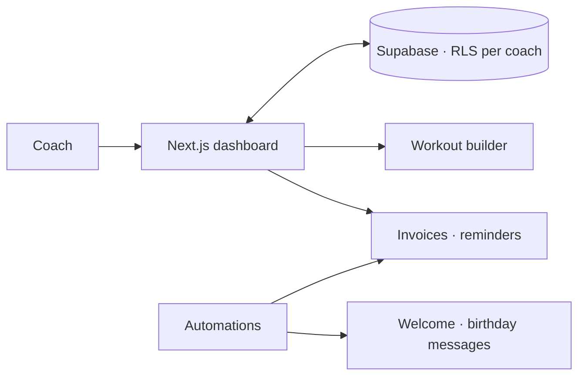

<div align="center">


<p>
  <a href="https://setra-fitness-crm.vercel.app"></a>
  
  
  
</p>

<p><em>A CRM built for solo fitness coaches and small studios, right where HubSpot and Salesforce stop understanding the work.<br>
Track progress, manage plans and collect payments from one dashboard.</em></p>

</div>


## Features

| | |
|---|---|
| **Dashboard** | Total clients, monthly revenue, overdue payments and trend charts at a glance. |
| **Client management** | Profile, tags, medical notes, payment plan and goals on one screen. |
| **Workout builder** | A drag-and-drop weekly plan editor with reusable templates and supersets. |
| **Progress** | Body metrics and performance tracked over time. |
| **Payments** | Monthly invoices generated automatically, reminder emails and revenue charts. |
| **Automations** | Payment reminders, welcome messages and birthday wishes: set once, run forever. |
| **Bilingual** | Turkish and English across the whole interface. |
| **Secure** | Supabase Auth with row-level security, so every coach's data is isolated. |
| **Self-hosted** | Docker and Nginx on your own server, or a Cloudflare Tunnel for easy TLS. |




## Türkçe özet

**Setra**, solo fitness koçları ve küçük stüdyolar için tasarlanmış dikey bir CRM. Genel CRM'lerin fitness iş akışını anlamadığı yerde devreye giriyor: müşteri profilleri, sürükle-bırak antrenman planları, ilerleme takibi, otomatik faturalar ve ödeme hatırlatmaları tek panelde. Supabase ile her koçun verisi ayrı tutuluyor; Docker ile kendi sunucunda çalıştırılabiliyor.


## Development

```sh
npm install
cp .env.example .env.local   # Supabase URL and keys
npm run dev                  # http://localhost:3000
npm run type-check
docker compose up -d         # self-hosted with Nginx
```

<div align="center">
<br>
<a href="https://github.com/kutluhangil"></a>
<sub>Spreadsheets out. Coaching in.</sub>
</div>
