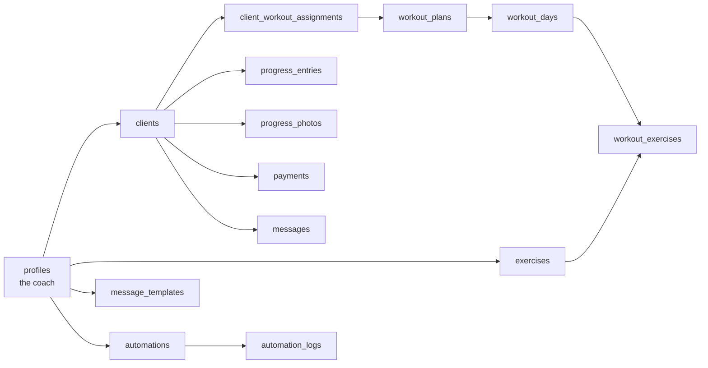

<div align="center">



<p>
  
  
  
  
</p>

<p><em>A vertical CRM for solo fitness coaches and small studios: clients, workout plans, progress,<br>
payments and the messages in between. Built phase by phase; the foundation is in place.</em></p>

</div>


## The idea

General CRMs do not know what a training block is, that a client's goal changes every quarter, or that a coach's real admin is chasing the monthly fee and remembering birthdays. Setra is shaped around that day: one profile per client with goals and medical notes, workout plans built from an exercise library and assigned to clients, progress with measurements and photos, monthly payments, message templates, and small automations that do the reminding.

> **Where it stands.** The project follows a thirteen-phase plan in `FITCRM_PROJECT_SPEC.md`. The infrastructure, the full database schema with row-level security, the dashboard shell, the landing and pricing pages and the Docker setup are done. The feature screens are being built next; each one shows which phase brings it.


## What works today

| | |
|---|---|
| **Landing page** | Hero, features, a dashboard preview, pricing in TRY or USD with a monthly / yearly switch, and a language toggle. |
| **Auth** | Sign up, log in and password reset with Supabase Auth; the middleware keeps `/dashboard` behind a session. |
| **Dashboard shell** | A greeting from the coach's profile, stat cards (clients, active clients, monthly revenue, payments due), a 30-day revenue chart, upcoming payments, an activity feed and quick actions. Layout with sidebar, top bar and mobile navigation. |
| **Database** | Fourteen tables for the whole product, each locked to its coach by RLS. |
| **Self-hosting** | A Dockerfile, `docker-compose.yml` with nginx, and a health endpoint. |
| **TR / EN** | Turkish first, English available. |


## Roadmap

| Phase | Area | State |
|---|---|---|
| 1 · 2 · 3 | Infrastructure, database and core, dashboard shell | Done |
| 4 | Client management: profiles, tags, goals, medical notes | Next (empty state and "add client" route in place) |
| 5 | Workout plans: drag-and-drop builder, exercise library, templates | Next |
| 6 | Progress: body measurements, charts, photo comparison | Planned |
| 7 | Payments: monthly records, reminders, revenue | Planned |
| 8 | Messages: threads, templates, email | Planned |
| 9 | Automations: payment reminders, welcome and birthday messages | Planned |
| 10 | Subscription billing with Lemon Squeezy | Planned |
| 11 · 12 | Landing and marketing, Docker and deploy | Done |
| 13 | Final polish | Planned |


## The data model



Every table carries the coach's id, and sixteen RLS policies make sure a coach only ever reads and writes their own rows.

| Plan | For | Monthly | Yearly |
|---|---|---|---|
| Solo | one coach | ₺799 · $29 | ₺7,670 · $278 |
| Studio | a small team | ₺2,199 · $79 | ₺21,110 · $758 |

<sub>Prices are the landing page's planned tiers; billing is phase 10.</sub>


## Türkçe özet

**Setra**, solo fitness koçları ve küçük stüdyolar için tasarlanan dikey bir CRM. Hedef: müşteri profilleri, egzersiz kütüphanesinden kurulan antrenman planları, ölçüm ve fotoğrafla ilerleme takibi, aylık ödemeler, mesaj şablonları ve hatırlatma otomasyonları tek panelde. Proje 13 fazlık bir plana göre ilerliyor: altyapı, RLS'li 14 tabloluk veritabanı, panel iskeleti, tanıtım ve fiyat sayfası ve Docker kurulumu hazır; müşteri yönetimi ve antrenman planlayıcı sırada.


## Development

```sh
npm install
cp .env.example .env.local
npm run dev                  # http://localhost:3000
npm run type-check
docker compose up -d         # app + nginx
```

`.env.local` takes `NEXT_PUBLIC_SUPABASE_URL`, `NEXT_PUBLIC_SUPABASE_ANON_KEY`, `SUPABASE_SERVICE_ROLE_KEY`, `NEXT_PUBLIC_APP_URL` and `NEXT_PUBLIC_DEFAULT_LOCALE`. The Lemon Squeezy, Resend and `CRON_SECRET` entries are there for the later phases. `SETUP_GUIDE.md` walks through Supabase and Docker.

```
src/app/              landing, (auth), dashboard and its sections, api/health
src/components/       landing, layout, dashboard, ui
src/lib/              supabase clients, types, date / currency / motion utils
supabase/migrations/  8 migrations: profiles, clients, workouts, payments, messages, progress, automations, RLS
FITCRM_PROJECT_SPEC.md  the full product spec and phase plan
```

<div align="center">
<br>
<a href="https://github.com/kutluhangil"></a>
<sub>MIT licensed · one dashboard, every client · names and numbers in the banner are placeholders.</sub>
</div>
